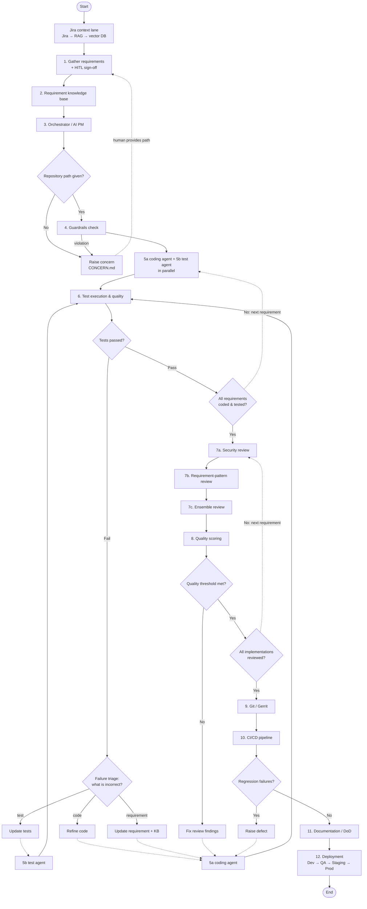

# Coding Agents in the Enterprise SDLC: Guardrails, Review Load and Real Productivity on Private Repositories.

# Coding Agents in the Enterprise SDLC

## Guardrails, Review Load and Real Productivity on Private Repositories

## Overview

AI coding agents are increasingly being introduced into software development workflows to assist with code generation, bug fixing, testing, refactoring, and pull request creation.

However, enterprise adoption requires more than measuring whether an agent can successfully generate code. Organizations must understand how coding agents behave inside real Software Development Life Cycle (SDLC) workflows, particularly when working with private repositories, security controls, CI/CD pipelines, branch protection rules, and human code review.

This project investigates the real impact of coding agents in enterprise software development by focusing on three key areas:

* **Guardrails** — How effectively enterprise policies and automated controls constrain agent behavior.
* **Review Load** — Whether coding agents reduce or increase the effort required from human reviewers.
* **Real Productivity** — Whether coding agents produce measurable engineering productivity gains after accounting for review, rework, failures, and operational cost.

---

## Problem Statement

Most coding-agent evaluations focus on benchmark completion rates or code-generation accuracy.

These metrics do not fully represent enterprise software development.

In real development environments, coding agents must operate within:

* Private repositories
* Repository permissions
* Branch protection policies
* CI/CD pipelines
* Automated testing
* Static analysis
* Security scanning
* Dependency policies
* Pull request reviews
* Human approvals

An agent may successfully generate code but still create significant review effort, introduce security issues, violate repository policies, or require substantial human correction.

Therefore, this project evaluates whether coding agents provide **net productivity improvements under realistic enterprise SDLC constraints**.

---

## Research Question

> Under enterprise-grade guardrails, do coding agents produce measurable productivity improvements on private repositories after accounting for human review effort, rework, failures, security constraints, and operational cost?

---

## Objectives

The main objectives of this project are to:

1. Build an agent-based coding workflow that operates on private GitHub repositories.
2. Introduce enterprise-style guardrails around agent actions.
3. Integrate automated testing, static analysis, and security checks.
4. Measure the amount of human review required for agent-generated changes.
5. Track agent failures, retries, and rework.
6. Compare agent-assisted development with traditional human development workflows.
7. Measure the real productivity impact of coding agents.

---

## Proposed Workflow

```text
Issue / Development Task
          |
          v
+-------------------------+
| Coding Agent            |
| Orchestrator            |
+-----------+-------------+
            |
            v
+-------------------------+
| Repository Analysis     |
+-----------+-------------+
            |
            v
+-------------------------+
| Task Planning           |
+-----------+-------------+
            |
            v
+-------------------------+
| Code Modification       |
+-----------+-------------+
            |
            v
+-------------------------+
| Enterprise Guardrails   |
| - File restrictions     |
| - Permission controls   |
| - Secret detection      |
| - Dependency policies   |
+-----------+-------------+
            |
            v
+-------------------------+
| Test & Quality Checks   |
| - Unit tests            |
| - Static analysis       |
| - Security scanning     |
+-----------+-------------+
            |
            v
+-------------------------+
| Pull Request Creation   |
+-----------+-------------+
            |
            v
+-------------------------+
| Human / AI Review       |
+-----------+-------------+
            |
            v
      Fix / Rework
            |
            v
       Merge / Reject
            |
            v
+-------------------------+
| Metrics & Evaluation    |
+-------------------------+
```

---

## Agentic SDLC Framework (`src/agentic_sdlc`)

The framework is the executable version of
[`docs/presentation/Agentic_SDLC_Flowdiagram1.html`](docs/presentation/Agentic_SDLC_Flowdiagram1.html).
It takes requirement documents (and optionally Jira issues) plus a target repository. It then drives
those requirements through coding, testing, review, Git/Gerrit integration, CI/CD, documentation and
deployment, with guardrails and human approval gates along the way.

Design principles:

* **One step per diagram box.** `orchestrator.py` is a state machine. Every box in the diagram is a
  node, every diamond is a decision node, and every dashed arrow is a feedback loop. The node names
  below are the ones that appear in `events.jsonl`.
* **Every loop is bounded.** Each feedback loop has a limit in `sdlc.yaml` (`loops.*`), plus a global
  `loops.max_steps` safety stop.
* **Offline by default, live when configured.** The framework runs with no credentials: a stub LLM,
  dry-run Git and deploy, and auto-approved human gates. Jira, ChromaDB, Gerrit and a real LLM are
  switched on through config. Credentials come only from environment variables.
* **Every agent write goes through guardrails.** No file reaches disk without passing `guardrails.py`.
* **Every step is audited.** Each node entry and outcome is appended to `events.jsonl`.

### Quick start

```bash
pip install -e .
# Run on a copy: the agents write files into the target repository.
cp -r examples/sample_repo /tmp/sample_repo
python -m agentic_sdlc run --requirements examples/requirements.md --repo /tmp/sample_repo
python -m agentic_sdlc benchmark --dataset examples/benchmark.json
```

On Windows use `py -m agentic_sdlc ...` and `Copy-Item -Recurse` instead of `cp -r`.

Example output:

```text
run 20261020-120726-181ce9: finished at 'end'
  REQ-001      approved       score=1.00 fix_iter=0 review_iter=0
  REQ-002      approved       score=1.00 fix_iter=0 review_iter=0
  knowledge_base: .agentic_sdlc/runs/20261020-120726-181ce9/knowledge_base.json
  traceability: .agentic_sdlc/runs/20261020-120726-181ce9/traceability.md
  dod: .agentic_sdlc/runs/20261020-120726-181ce9/DoD.md
  release_notes: .agentic_sdlc/runs/20261020-120726-181ce9/release_notes.md
  events: .agentic_sdlc/runs/20261020-120726-181ce9/events.jsonl
```

### Flow at a glance



The same flow as a node-by-node table. The node names are exactly what appears in `events.jsonl`.

| # | Node | Diagram box | Module | Next |
|---|---|---|---|---|
| – | `start` | Start | `orchestrator.py` | `jira_context` |
| – | `jira_context` | Jira dashboard → RAG → vector DB | `jira.py`, `knowledge_base.py` | `gather` |
| 1 | `gather` | Gather requirements (HITL) | `knowledge_base.py`, `hitl.py` | `knowledge_base`, or halt on concern |
| 2 | `knowledge_base` | Requirement knowledge base | `knowledge_base.py` | `planner` |
| 3 | `planner` | Orchestrator agent (AI PM) | `orchestrator.py`, `prompts/TaskPlanner.md` | `repo_given?` |
| ◇ | `repo_given?` | Repository path given by human? | `orchestrator.py` | `guardrails` / `concern` |
| – | `concern` | Raise concern | `orchestrator.py` | `gather` (path supplied) / halt |
| 4 | `guardrails` | Guardrails check | `guardrails.py`, `repo_adapter.py` | `develop` / `concern` |
| 5 | `develop` | 5a coding + 5b test agent in parallel | `agents/coding.py`, `agents/testing.py` | `evaluate` |
| 5a | `coder` | Coding agent (refinement) | `agents/coding.py` | `evaluate` (or `tester` if no tests yet) |
| 5b | `tester` | Test agent (test fix) | `agents/testing.py` | `evaluate` |
| 6 | `evaluate` | Test execution & quality | `quality.py` | `tests_passed?` |
| ◇ | `tests_passed?` | Tests passed? | `orchestrator.py` | `all_coded?` / `security_review` / `triage` |
| ◇ | `triage` | Failure analysis | `quality.py`, `prompts/FailureTriage.md` | `fix_test` / `fix_code` / `fix_requirement` |
| – | `fix_test` / `fix_code` / `fix_requirement` | Fix boxes | `orchestrator.py`, `hitl.py` | `tester` / `coder` / `coder` |
| ◇ | `all_coded?` | All requirements coded & tested? | `orchestrator.py` | `develop` (next) / `security_review` |
| 7a | `security_review` | Security code review | `agents/review.py` | `pattern_review` |
| 7b | `pattern_review` | Requirement-pattern review | `context_engine.py` | `ensemble_review` |
| 7c | `ensemble_review` | Ensemble-based review | `ensemble.py`, `agents/review.py` | `quality_scoring` |
| 8 | `quality_scoring` | Quality scoring | `metrics.py` | `quality_met?` |
| ◇ | `quality_met?` | Quality threshold met? | `orchestrator.py` | `all_reviewed?` / `review_fix` |
| – | `review_fix` | Fix review findings | `orchestrator.py` | `coder` / `all_reviewed?` (limit reached) |
| ◇ | `all_reviewed?` | All implementations reviewed? | `orchestrator.py` | `security_review` (next) / `gerrit` |
| 9 | `gerrit` | Integrate into Git / Gerrit | `vcs.py` | `cicd`, or halt on failure |
| 10 | `cicd` | CI/CD pipeline | `cicd.py` | `regression?` |
| ◇ | `regression?` | Regression failures found? | `orchestrator.py` | `dod` / `defect` |
| – | `defect` | Raise defect → code refinement | `orchestrator.py`, `jira.py` | `coder`, or halt at limit |
| 11 | `dod` | Update documentation (DoD) | `docs.py` | `deploy` |
| 12 | `deploy` | Start deployment | `deploy.py` | `end` |

A happy-path run with one requirement visits exactly:

```text
start > jira_context > gather > knowledge_base > planner > repo_given? > guardrails > develop >
evaluate > tests_passed? > all_coded? > security_review > pattern_review > ensemble_review >
quality_scoring > quality_met? > all_reviewed? > gerrit > cicd > regression? > dod > deploy > end
```

With several requirements, Part 1 (`develop` → `evaluate`) repeats once per requirement before any
review starts. Part 2 (`security_review` → `quality_met?`) then repeats once per requirement that
passed its tests.

### Step-by-step walkthrough

#### Part 1 — Requirements, implementation and testing

**Jira context lane (`jira_context`).** The framework pulls work items from Jira and pushes each one
into the knowledge base's vector store, so later steps can retrieve it as context. There are two
sources:

* an offline Jira JSON export, set by `jira.issues_file`;
* live Jira REST, when `jira.enabled: true` and `jira.jql` is set.

Each issue becomes a requirement. The issue key is the ID and the summary is the title. Bullets after
an "Acceptance criteria" line in the description become acceptance criteria.

**1. Gather requirements (`gather`).** This step parses every `--requirements` file and merges the
result with the Jira requirements. If a document and a Jira issue share an ID, the document wins.
A human then signs off the requirement set at the `requirements_signoff` HITL gate. The run halts
with `CONCERN.md` in two cases: no requirements were found, or the sign-off is refused.

**2. Requirement knowledge base (`knowledge_base`).** Every requirement is stored in the vector
store, and the registry is saved to `knowledge_base.json`. When the coding and test agents work on a
requirement, they retrieve the top-k most similar *other* requirements (`knowledge_base.top_k`) as
RAG context. The default store is a dependency-free keyword cosine store; ChromaDB is optional.

**3. Orchestrator / AI PM (`planner`).** The LLM, using `prompts/TaskPlanner.md`, produces one task
per requirement describing what to code and what to test. The orchestrator then creates a per-requirement
work record and queues the requirements for Part 1.

**Decision: repository path given? (`repo_given?`).** If `--repo` was not supplied, the flow goes to
`concern`.

**Raise concern (`concern`).** This writes `CONCERN.md` and asks the human for a repository path.
The question is only asked in `--interactive` mode; in auto mode the run halts. If the human
supplies a path, the flow loops back to `gather`, matching the "Human provides repository path /
access" arrow in the diagram.

**4. Guardrails (`guardrails`).** This step checks four things:

* the repository exists and is readable and writable;
* Gerrit is in `guardrails.allowed_mcp` when `vcs.mode` is `gerrit`;
* the build/test/lint commands for the repository's stack can be detected (`repo_adapter.py`);
* (on every later write) each file passes the checks in [Guardrails in detail](#guardrails-in-detail).

Any repository or approval violation goes to `concern`. On success, the first requirement is
selected.

**5a + 5b. Coding and test agents (`develop`).** For the current requirement, the coding agent
(`prompts/CodingAgent.md`) and the test agent (`prompts/TestAgent.md`) run **in parallel** on two
threads. Each sends the LLM:

* the requirement text;
* the related requirements retrieved from the knowledge base;
* the repository file tree;
* the current content of the files it owns;
* any feedback from a previous attempt.

The LLM replies with JSON: `{"files": [{"path": ..., "content": ...}]}`. Each file goes through the
guardrails before being written. The test agent may only write test files. Blocked writes are kept
as "pending violations" and make the next evaluation fail, so the agent is asked to try again.

**6. Test execution and quality (`evaluate`).** If there are pending guardrail violations, the
evaluation fails immediately with the violation list as output. Otherwise it runs the detected
build, lint and test commands in the repository. If `quality.min_coverage` is set and the test output
contains a coverage `TOTAL` line, coverage below the threshold also fails the step.

**Decision: tests passed? (`tests_passed?`).**

* Pass, in Part 1: the requirement is marked `tested` and the flow goes to `all_coded?`.
* Pass, during a review or regression fix: the flow goes back into review (`security_review`).
* Fail: the flow goes to `triage`.

**Failure triage (`triage`).** The LLM (`prompts/FailureTriage.md`) classifies the failure:

| Category | Meaning | Next node | Loop arrow in diagram |
|---|---|---|---|
| `test` | The test case is incorrect | `fix_test` → `tester` → `evaluate` | re-test |
| `code` | The code is incorrect | `fix_code` → `coder` → `evaluate` | re-code |
| `requirement` | The requirement is ambiguous or wrong | `fix_requirement` → `coder` → `evaluate` | update KB |

For `requirement`, the human is asked for a clarification (HITL `requirement_update`). In auto mode,
the triage reason is recorded as a note. The note is added to the requirement, the knowledge base is
updated and saved, and the requirement is re-implemented.

After `loops.max_fix_iterations` attempts, the requirement is marked `blocked` and the flow moves on
to the next requirement.

**Decision: all requirements coded and tested? (`all_coded?`).** If requirements remain in the
queue, the next one goes to `develop` (the "No – next requirement" arrow). Otherwise the flow
switches to Part 2. The Part 2 queue holds every requirement whose status is `tested`.

#### Part 2 — Review, integration, CI/CD and deployment

Steps 7a–8 run once for each tested requirement (the "Review Agent – iterated for every requirement
implementation" frame in the diagram).

**7a. Security code review (`security_review`).** This is SAST, secrets and dependency scanning over
the requirement's changed files:

* built-in rules: `eval`/`exec`, `shell=True`, `os.system`/`popen`, `pickle.load(s)`, unsafe
  `yaml.load`, MD5/SHA-1, `verify=False`, SQL built from string formatting, `DEBUG = True`;
* a secrets scan using the guardrail patterns. Secrets are always `critical`, including in test files;
* with `review.external_tools: auto`, `bandit` (Python files) and `pip-audit` (`requirements.txt`)
  run when they are installed. `semgrep` runs when listed explicitly.

**7b. Requirement-pattern review (`pattern_review`, `context_engine.py`).** This checks traceability
from code to requirement. An acceptance criterion counts as traced when its text appears in the code
or tests, or when at least 60% of its keywords appear. The step reports:

* each untraced criterion (`low`);
* no tests at all (`medium`);
* the requirement ID not referenced anywhere in the change (`info`).

**7c. Ensemble review (`ensemble_review`).** An LLM reviewer (`ReviewAgent.md`, `SecurityReview.md`
and `PatternReview.md`) produces its own findings. There are then two voters:

* `rules`: the 7a and 7b findings (weight 0.6);
* `llm`: the LLM findings (weight 0.4).

Findings from different voters are grouped when they share a file and category and are within three
lines of each other. A group is kept as **consensus** when its weighted vote share is at least
`review.ensemble.threshold` (0.5), or when its severity is in `review.ensemble.always_keep`
(`critical`, `high`). Low-confidence findings raised by only one voter are dropped, which is how the
ensemble "removes noise".

**8. Quality scoring (`quality_scoring`).** The quality score is `1 − Σ severity weight` over the
consensus findings, clipped at 0. The weights are critical 1.0, high 0.5, medium 0.2, low 0.05 and
info 0. The step also computes accuracy, precision, recall and F1 for each voter against the
consensus. Everything is written to `review-<REQ>.json`.

**Decision: quality threshold met? (`quality_met?`).** A requirement passes when the score is at
least `quality.review_threshold` (0.7) **and** no consensus finding is in `quality.block_severities`
(`critical`, `high`). Passing requirements are marked `approved`.

**Fix review findings (`review_fix`).** The consensus findings become feedback for the coding agent
(task `fix_review`). The fix is re-tested (`evaluate`), and if the tests pass the requirement is
re-reviewed from 7a. After `loops.max_review_iterations` attempts, the requirement is marked
`review_failed` and is not integrated.

**Decision: all implementations reviewed? (`all_reviewed?`).** If requirements remain, the next one
goes to `security_review`. Otherwise the flow continues to `gerrit`.

**9. Git / Gerrit (`gerrit`, `vcs.py`).** This integrates every `approved` requirement. Behaviour
depends on `vcs.mode`:

| `vcs.mode` | Behaviour |
|---|---|
| `dry-run` (default) | Records the planned commits and the push command; nothing is changed |
| `git` | Creates branch `agentic/<run-id>` and makes one commit per requirement (`REQ-001: <title>`, with the acceptance criteria in the body) |
| `gerrit` | As `git`, plus a `Change-Id` trailer per commit. Pushes `HEAD:refs/for/<branch>%topic=agentic/<run-id>`, reads each change through the Gerrit REST API, then asks the human `merge` gate. With `vcs.gerrit.auto_submit: true` and approval, it votes Code-Review +2 and submits; otherwise the change waits for a human Code-Review +2 |

Any Git failure halts the run with `CONCERN.md`.

**10. CI/CD pipeline (`cicd`).** This runs `ci.command` if set (Jenkins, GitLab CI, Zuul, or any
command). Otherwise it runs the repository's full build + lint + test suite as the regression gate.

**Decision: regression failures found? (`regression?`) and Raise defect (`defect`).** A failing
pipeline goes to `defect`, which does the following:

1. Creates a Jira defect, if `jira.enabled` and `jira.defect_project` are set.
2. Resets every approved requirement to `tested`.
3. Sends the CI output to the coding agent as feedback, through the first approved requirement.
4. Re-tests and re-reviews **all** approved requirements, then integrates and runs CI again.

After `loops.max_ci_iterations` attempts, the run halts with `CONCERN.md`.

**11. Documentation / DoD (`dod`, `docs.py`).** This writes:

* `traceability.md`: requirement → code files → test files → criteria traced → score;
* `DoD.md`: the Definition of Done checklist, each item ticked from the actual run state. In
  dry-run, "integrated into Git / Gerrit" stays unticked;
* `release_notes.md`: delivered requirements, plus the ones not delivered and why.

**12. Deployment (`deploy`).** This promotes through `deploy.environments` in order, with a
`deploy:<env>` HITL approval for each environment. If `deploy.dry_run: false` and `deploy.command`
is set, it runs the command with `{env}` replaced (for example `helm upgrade app ./chart -n {env}`).
Promotion stops at the first rejected or failed environment.

### Feedback loops and limits

| Loop (diagram arrow) | Trigger | Route | Limit (`sdlc.yaml`) | When the limit is hit |
|---|---|---|---|---|
| Human provides repository path | Repo missing or guardrail violation | `concern` → `gather` | human answer | halt with `CONCERN.md` |
| re-test | Triage says `test` | `fix_test` → `tester` → `evaluate` | `loops.max_fix_iterations` (3) | requirement `blocked` |
| re-code | Triage says `code` | `fix_code` → `coder` → `evaluate` | `loops.max_fix_iterations` | requirement `blocked` |
| update KB | Triage says `requirement` | `fix_requirement` → `coder` → `evaluate` | `loops.max_fix_iterations` | requirement `blocked` |
| No – next requirement (Part 1) | Queue not empty | `all_coded?` → `develop` | number of requirements | – |
| Fix review findings | Score below threshold or blocking finding | `review_fix` → `coder` → `evaluate` → `security_review` | `loops.max_review_iterations` (2) | requirement `review_failed` |
| No – review next requirement | Review queue not empty | `all_reviewed?` → `security_review` | number of tested requirements | – |
| Raise defect | CI regression failure | `defect` → `coder` → `evaluate` → review → `gerrit` → `cicd` | `loops.max_ci_iterations` (2) | halt with `CONCERN.md` |
| Safety stop | Any runaway path | – | `loops.max_steps` (500) | halt |

The three fix loops share one counter per requirement (`fix_iterations`).

### Requirement statuses

| Status | Meaning |
|---|---|
| `pending` | Planned, not yet passing tests |
| `tested` | Tests pass; waiting for review |
| `approved` | Passed review; integrated into Git/Gerrit |
| `blocked` | Still failing after `max_fix_iterations`; not reviewed or integrated |
| `review_failed` | Still failing review after `max_review_iterations`; not integrated |

Blocked and review-failed requirements are listed under "Not delivered" in `release_notes.md`.

### Writing requirements

These formats are supported: `.md`, `.txt`, `.html`, `.json`, `.docx` (Confluence exports work as
HTML or DOCX). A requirement starts at either:

* a `##` (or deeper) heading, or
* a line of the form `ID: title`, where the ID looks like `REQ-001` or `CAP-12`.

Bullets after an "Acceptance criteria" line become acceptance criteria; other text is the
description. Requirements without an ID are numbered `REQ-001`, `REQ-002`, and so on.

```markdown
## REQ-001: Subtract two numbers

The calculator must support subtraction.

Acceptance criteria:
- subtract returns the difference of two numbers
- subtract supports negative results
```

JSON input is a list, or `{"requirements": [...]}`, of objects with `id`, `title`, `description`
and `acceptance_criteria`.

### Guardrails in detail

Every file an agent wants to write is checked by `Guardrails.check_write`. A file is blocked if any
rule fails:

| Rule | Blocks |
|---|---|
| `path_traversal` | Absolute paths, `..`, or anything resolving outside the repository |
| `restricted_path` | `guardrails.restricted_paths`: `.git/`, `.github/workflows/`, `secrets/`, `.env`, `id_rsa` |
| `tests_only` | The test agent writing outside test paths (`tests/`, `test_*.py`, `*.test.js`, `*Test.java`, ...) |
| `file_size` | Files larger than `guardrails.max_file_bytes` (200 kB) |
| `secret` | Lines matching `guardrails.secret_patterns`: AWS keys, private keys, GitHub tokens, Slack tokens, `password/secret/api_key/token = "..."` |

Repository-level checks: the repository must exist and be readable and writable, and any
integration or MCP used (for example Gerrit) must be listed in `guardrails.allowed_mcp`.

### Human-in-the-loop gates

| Gate | When | Auto mode (default) | `--interactive` |
|---|---|---|---|
| `requirements_signoff` | After gathering requirements | Approved if listed in `hitl.auto_approve` | y/N prompt |
| Repository path | Concern raised | Run halts | Prompt for a path |
| `requirement_update` | Triage says the requirement is wrong | Triage reason recorded as a note | Prompt for a clarification |
| `merge` | Gerrit changes pushed | Approved if listed | y/N prompt |
| `deploy:<env>` | Before each environment | Approved if listed | y/N prompt |

Remove a gate from `hitl.auto_approve` to make auto mode reject it. For example, with
`auto_approve: [requirements_signoff]`, Gerrit changes wait for a human Code-Review +2 and no
environment is deployed.

### Run artifacts

Each run writes to `<project.output_dir>/<run-id>/` (default `.agentic_sdlc/runs/`, or `--out`):

| File | Content |
|---|---|
| `events.jsonl` | Audit log: one JSON line per node entry and outcome (timestamp, run id, stage, event, data) |
| `knowledge_base.json` | Requirements, including human clarifications |
| `review-<REQ>.json` | Findings per reviewer, consensus, vote groups, traceability, score, pass/fail, reviewer metrics |
| `traceability.md` | Traceability matrix |
| `DoD.md` | Definition of Done checklist |
| `release_notes.md` | Delivered and not-delivered requirements |
| `CONCERN.md` | Only when a concern was raised: the reason the run stopped |

### Command line

```text
python -m agentic_sdlc run --requirements FILE [FILE ...] [--repo PATH] [--config YAML]
                           [--out DIR] [--llm stub|openai] [--vcs dry-run|git|gerrit] [--interactive]
python -m agentic_sdlc benchmark [--runs DIR | --dataset FILE] [--config YAML] [--json]
```

* `run` exits with `0` when the flow reaches `end`, and `2` when it halts on a concern.
* `benchmark --runs DIR` aggregates reviewer accuracy, precision, recall and F1 from every
  `review-*.json` under `DIR`.
* `benchmark --dataset FILE` scores labelled data instead
  (`{"items": [{"truth": true, "predictions": {"rules": true, "llm": false}}]}`); see
  `examples/benchmark.json`.

### Configuration

All defaults live in [`src/agentic_sdlc/sdlc.yaml`](src/agentic_sdlc/sdlc.yaml). Pass
`--config my.yaml` with only the keys you want to change; your file is deep-merged over the
defaults.

| Section | Key settings |
|---|---|
| `project` | `output_dir` |
| `llm` | `provider` (`stub` / `openai`), `model`, `base_url`, `api_key_env`, `api_key_header`, `api_version`, `temperature` |
| `jira` | `enabled`, `base_url`, `jql`, `search_path`, `issues_file`, `defect_project`, `defect_issuetype`, `user_env`, `token_env` |
| `knowledge_base` | `store` (`json` / `chroma`), `top_k`, `chroma.path`, `chroma.collection`, `chroma.embedding` |
| `hitl` | `mode` (`auto` / `interactive`), `auto_approve` |
| `guardrails` | `require_repo`, `restricted_paths`, `test_paths`, `max_file_bytes`, `allowed_mcp`, `secret_patterns` |
| `loops` | `max_fix_iterations`, `max_review_iterations`, `max_ci_iterations`, `max_steps` |
| `quality` | `min_coverage`, `review_threshold`, `block_severities` |
| `review` | `external_tools` (`auto` / `none` / list), `ensemble.weights`, `ensemble.threshold`, `ensemble.always_keep` |
| `repo` | `build_command`, `test_command`, `lint_command`: override detection; `"none"` disables a step |
| `vcs` | `mode`, `remote`, `branch`, `branch_prefix`, `gerrit.url`, `gerrit.auto_submit`, `gerrit.user_env`, `gerrit.token_env` |
| `ci` | `command` |
| `deploy` | `environments`, `command` (`{env}` placeholder), `dry_run` |

Example: real LLM through Ollama, live Jira and Gerrit, stricter review:

```yaml
llm: {provider: openai, base_url: http://localhost:11434/v1, model: llama3}
jira: {enabled: true, base_url: https://your-domain.atlassian.net,
       jql: 'project = CAP AND status = "To Do"', defect_project: CAP}
vcs: {mode: gerrit, branch: main, gerrit: {url: https://gerrit.example.com}}
quality: {review_threshold: 0.85, min_coverage: 80}
```

`OPENAI_API_KEY` must be set even for local servers such as Ollama; any value works there.

### Stack detection

`repo_adapter.py` picks the build, test and lint commands from the first marker file it finds. Any
of them can be overridden with `repo.*_command`.

| Stack | Marker | Build | Test | Lint |
|---|---|---|---|---|
| Maven | `pom.xml` | `mvn -B -q compile` | `mvn -B -q test` | – |
| Gradle | `build.gradle(.kts)` | `gradle assemble` | `gradle test` | – |
| Node | `package.json` | `npm run build --if-present` | `npm test` | `npx eslint .` |
| Go | `go.mod` | `go build ./...` | `go test ./...` | `go vet ./...` |
| Rust | `Cargo.toml` | `cargo build` | `cargo test` | `cargo clippy` |
| Python | `pyproject.toml`, `setup.py`, `setup.cfg`, `requirements.txt`, or any `.py` | `python -m compileall` | `python -m pytest` | `ruff check .` (if installed) |
| .NET | `*.sln`, `*.csproj` | `dotnet build` | `dotnet test` | – |

### Live integrations

| Integration | Config | Env vars |
|---|---|---|
| OpenAI / Azure OpenAI / Ollama / vLLM / LM Studio | `llm.provider: openai`, `llm.base_url`, `llm.model` (Azure: `api_key_header: api-key`, `api_version`) | `OPENAI_API_KEY` |
| Jira REST (Cloud or Data Center) | `jira.enabled: true`, `jira.base_url`, `jira.jql`, `jira.defect_project`; Jira Cloud: `jira.search_path: /rest/api/3/search/jql` | `JIRA_USER`, `JIRA_TOKEN` |
| ChromaDB | `knowledge_base.store: chroma` (`pip install -e .[chroma]`); `chroma.embedding: openai` for OpenAI embeddings | – |
| Gerrit | `vcs.mode: gerrit`, `vcs.gerrit.url`, `vcs.gerrit.auto_submit` | `GERRIT_USER`, `GERRIT_HTTP_PASSWORD` |
| CI / deploy | `ci.command`, `deploy.command`, `deploy.dry_run: false` | – |

HTTP calls use only the Python standard library (`httpclient.py`), and non-HTTP(S) URLs are refused.
Credentials are never written to the run artifacts.

### Offline stub LLM

With `llm.provider: stub` (the default), `llm.py` returns deterministic replies:

* a plan with one task per requirement;
* a scaffold module per requirement, `agentic_impl/<req_id>.py`, holding the requirement ID, title
  and acceptance criteria;
* matching pytest tests;
* a heuristic failure triage;
* an empty LLM review.

This proves the whole flow, loops and artifacts work without a model. It does **not** implement the
features; switch to a real LLM for that.

### Extending the framework

* **Another LLM backend:** implement `complete(task, system, user, context) -> str` (returning JSON)
  and pass it as `Orchestrator(cfg, llm=MyLLM())`.
* **Agent behaviour:** edit the prompt files in `src/agentic_sdlc/prompts/`
  (`TaskPlanner.md`, `CodingAgent.md`, `TestAgent.md`, `FailureTriage.md`, `ReviewAgent.md`,
  `SecurityReview.md`, `PatternReview.md`, `RequirementKnowledgeBase.skills.md`, `DoD.md`).
* **Custom human gates:** pass `HITL(cfg, input_fn=...)` to connect approvals to a chat bot or web UI.
* **Flow changes:** nodes and edges are declared in `Orchestrator.build_graph()`. The `Graph` API
  (add a node, add a conditional edge) follows LangGraph, so a LangGraph backend can be substituted
  without rewriting the nodes.

### Tests

```bash
pip install -e . pytest ruff bandit
pytest            # 55 tests
ruff check .
bandit -r src
```

| Test file | Covers |
|---|---|
| `tests/test_end_to_end.py` | Happy path matches the diagram, multiple requirements, missing-repo concern and human loop-back, sign-off refusal, Jira merge, CLI |
| `tests/test_loops.py` | Every feedback loop (re-test, re-code, update KB, guardrail violation, review fix, regression defect) and its limit |
| `tests/test_guardrails.py` | Secrets, restricted paths, traversal, tests-only writes, size limit, repo and MCP checks |
| `tests/test_knowledge_base.py` | MD / HTML / JSON / DOCX parsing, retrieval, persistence |
| `tests/test_review.py` | SAST and secrets, traceability, ensemble consensus, scoring, benchmark |
| `tests/test_repo_adapter.py` | Stack detection and command overrides |
| `tests/test_integrations.py` | Jira, OpenAI-compatible and Azure LLM, ChromaDB (network mocked); real Git and Gerrit push to a local bare repo |

### Known limitations

* The agents write into the repository given with `--repo`; run on a copy or a clean branch.
* A requirement that ends up `blocked` leaves its files in the working tree. The CI regression step
  then fails and the run halts with a concern; there is no automatic rollback.
* Regression fixes are routed through the first approved requirement, and all approved
  requirements are then re-reviewed.
* Traceability (7b) is a keyword heuristic. With a real LLM, the LLM reviewer in 7c adds semantic
  judgement.
* CI and deployment run configured commands; there are no dedicated Jenkins or Argo CD API clients.

---

## Key Research Dimensions

### 1. Guardrails

The project will investigate controls such as:

* Repository access restrictions
* Protected branches
* Restricted files and directories
* Secret detection
* Dependency restrictions
* Static code analysis
* Security scanning
* Required automated tests
* Pull request approval requirements
* Limits on autonomous agent actions

Possible metrics include:

* Guardrail violations
* Blocked agent actions
* Security issues detected
* Policy violations
* Unauthorized modification attempts

---

### 2. Review Load

A major goal is to determine whether coding agents actually reduce human engineering effort.

Review-related metrics may include:

* Human review time
* Number of review comments
* Number of requested changes
* Number of agent correction cycles
* Pull request rejection rate
* Rework required before merge
* Number of defects detected during review

---

### 3. Real Productivity

Productivity will not be measured only by code generated.

The project will evaluate metrics such as:

* Task completion rate
* Successful pull request rate
* Time to first pull request
* Time to merge
* Human intervention time
* Test pass rate
* Number of retries
* Defect rate
* Rework effort
* Agent execution cost
* Net engineering time saved

A simplified productivity measure may be represented as:

```text
Net Productivity Gain
=
Traditional Human Effort
-
(
Agent Execution Time
+ Human Review Time
+ Rework Time
+ Failure Recovery Cost
)
```

---

## Experimental Design

The project will use software engineering tasks such as:

* Bug fixes
* Feature additions
* Refactoring
* Test generation
* Documentation changes
* Dependency updates

Each task may be executed under different conditions.

### Baseline

Developer completes the task without a coding agent.

### Agent-Assisted

Developer uses a coding agent but remains actively involved.

### Agent-Driven

The coding agent performs most of the implementation and generates a pull request for review.

Results from these workflows can then be compared.

---

## Planned Architecture

```text
GitHub Private Repository
        |
        v
Coding Agent
        |
        v
Guardrail Layer
        |
        v
Code / Test Generation
        |
        v
CI/CD Pipeline
        |
        +---- Unit Tests
        |
        +---- Linting
        |
        +---- Static Analysis
        |
        +---- Security Scan
        |
        v
Pull Request
        |
        v
Human Review
        |
        v
Metrics Collection
        |
        v
Analytics / Evaluation
```

---

## Technology Stack

The expected technology stack may include:

### Repository & SDLC

* GitHub
* GitHub Private Repositories
* GitHub Issues
* GitHub Pull Requests
* GitHub Actions

### AI / Agent Framework

* Python
* LLM APIs
* Agent orchestration framework

### Code Quality

* Unit testing frameworks
* Linters
* Static analysis tools
* Security scanners

### Data & Analytics

* Python
* Pandas
* Matplotlib / visualization tools
* SQLite / PostgreSQL or another metrics store

### Deployment

Potential deployment options include:

* AWS
* Docker
* GitHub Actions runners

---

## Repository Structure

```text
Capstone-main/
|-- src/agentic_sdlc/
|   |-- __main__.py, cli.py      # `python -m agentic_sdlc run | benchmark`
|   |-- sdlc.yaml                # default configuration
|   |-- config.py                # YAML loading + deep merge, env-var secrets
|   |-- orchestrator.py          # 3. AI PM + state machine for the whole flow
|   |-- state.py                 # Requirement, Work, Finding, RunState, Status
|   |-- events.py                # events.jsonl audit log
|   |-- hitl.py                  # human-in-the-loop gates
|   |-- llm.py                   # stub LLM + OpenAI-compatible client
|   |-- jira.py                  # Jira context lane + defects
|   |-- knowledge_base.py        # 1-2. requirement parsing, RAG store (keyword / ChromaDB)
|   |-- guardrails.py            # 4. guardrails
|   |-- repo_adapter.py          # stack detection -> build/test/lint commands
|   |-- agents/
|   |   |-- __init__.py          # guarded file writes, shared agent base
|   |   |-- coding.py            # 5a. coding agent
|   |   |-- testing.py           # 5b. test agent
|   |   `-- review.py            # 7a security review + LLM reviewer
|   |-- quality.py               # 6. test execution + failure triage
|   |-- context_engine.py        # 7b. requirement-pattern review
|   |-- ensemble.py              # 7c. ensemble consensus
|   |-- metrics.py               # 8. quality score, precision / recall / F1, benchmark
|   |-- vcs.py                   # 9. Git / Gerrit
|   |-- cicd.py                  # 10. CI/CD
|   |-- docs.py                  # 11. DoD documentation
|   |-- deploy.py                # 12. deployment
|   |-- shell.py, httpclient.py  # subprocess and HTTP helpers
|   `-- prompts/*.md             # agent prompts
|-- examples/
|   |-- requirements.md          # sample requirements
|   |-- jira_issues.json         # sample Jira export
|   |-- benchmark.json           # labelled reviewer benchmark
|   `-- sample_repo/             # tiny Python repository to run against
|-- tests/                       # pytest suite
|-- docs/                        # presentations, diagrams, papers
|-- .github/workflows/ci.yml     # lint (ruff), tests (pytest), security (bandit)
|-- pyproject.toml
`-- requirements-dev.txt
```

---

## Expected Outcomes

The project aims to determine:

* Whether coding agents reduce overall development effort.
* Which types of software engineering tasks benefit most from coding agents.
* How much review effort agent-generated code requires.
* Which enterprise guardrails are most important.
* How frequently agents violate repository or security policies.
* Whether faster code generation results in faster software delivery.
* The true productivity gain after accounting for review and rework.

---

## Future Work

Possible extensions include:

* Multi-agent coding workflows
* AI-based pull request review
* Reinforcement learning for agent policy selection
* Agent performance across multiple programming languages
* Cost-aware agent routing
* Long-running autonomous development tasks
* Comparison of different coding models
* Enterprise-scale repository experiments

---

## Project Status

**Current Phase:** Agentic SDLC framework implemented (`src/agentic_sdlc`), with guardrails,
coding/test/review agents, Gerrit integration, CI/CD gate, DoD and deployment, covered by 55 tests.

Planned next steps:

1. Run the framework with a real LLM against baseline private repositories.
2. Connect live Jira and Gerrit instances.
3. Tune guardrail policies and review thresholds.
4. Run the baseline / agent-assisted / agent-driven experiments.
5. Analyze productivity and review-load results from `events.jsonl` and `review-*.json`.

---

## Disclaimer

This project is intended for academic and research purposes.

Experiments involving autonomous coding agents should be performed in controlled repositories with appropriate access restrictions, review processes, and security controls.
